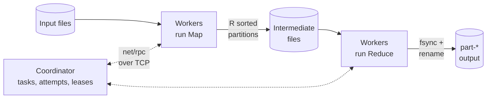
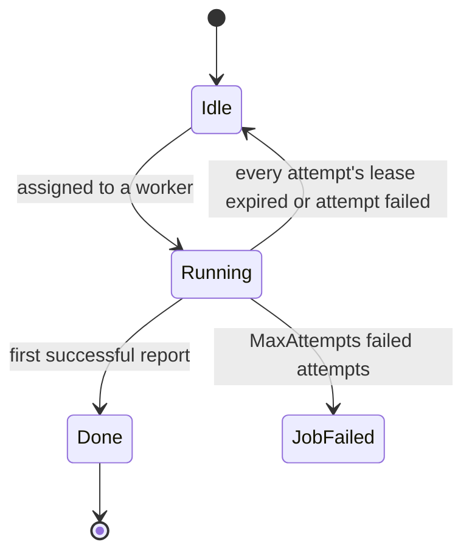

# mapreduce

[](https://github.com/MSJawad/mapreduce/actions/workflows/ci.yml)

A distributed MapReduce framework in Go, built on the design in Google's
MapReduce paper. A coordinator splits a job into map and reduce tasks and hands
them out over TCP to any number of workers. It keeps going when workers crash,
hang or run slowly, and it commits output atomically, so the result always
matches a sequential run of the same job.

- **Fault tolerant**: workers hold renewable task leases. When a worker goes
  quiet, its task runs again somewhere else. When a worker is slow, a backup
  attempt races it. The first attempt to finish wins.
- **Correct output**: each attempt writes to private files and commits with
  an atomic rename. Partial output from a crashed worker is never read.
  Tests check every result against a sequential reference.
- **Batteries included**: word count, inverted index and distributed grep jobs,
  a single CLI, and a Docker Compose demo on Project Gutenberg books.
- **Tested**: the tests kill workers mid-task, crash them after partial
  writes, slow them down, and SIGKILL real worker processes. Everything runs
  under the race detector in CI.

```console
$ scripts/demo.sh            # 1 coordinator + 4 workers in Docker, 8 books
...
msg="job complete" elapsed=1.431s outputs=8
output matches the sequential reference: 27357 keys in data/output/
most frequent words:
  the      51959
  and      31660
  of       26377
```

## Quick start

You need Go 1.25 or newer, or only Docker for the Compose demo.

**One process, many workers.** This is the fastest way to try it:

```sh
go run ./cmd/mapreduce local -workers 4 -out /tmp/wc 'path/to/books/*.txt'
cat /tmp/wc/part-* | sort -t$'\t' -k2,2nr | head
```

**Separate processes over TCP**, as you would deploy it. All processes must see
the input and output paths at the same location: the same machine, or a shared
filesystem.

```sh
go build -o mapreduce ./cmd/mapreduce
./mapreduce coordinator -listen :7070 -job index -out /tmp/index 'books/*.txt' &
./mapreduce worker -coordinator localhost:7070 &
./mapreduce worker -coordinator localhost:7070 &
./mapreduce worker -coordinator localhost:7070
```

Start and stop workers whenever you like. The coordinator schedules whoever is
connected, and anything a dead worker held runs again elsewhere.

**Docker Compose demo.** `scripts/demo.sh` downloads eight public-domain books
from Project Gutenberg (about 6 MB, into `data/`, which git ignores). It then
starts one coordinator and four workers in containers that share a volume,
waits for the job, and checks the output against a sequential run.

```sh
scripts/demo.sh
WORKERS=8 JOB=index scripts/demo.sh
JOB=grep PARAM='pattern=(?i)\bwhite whale\b' scripts/demo.sh
CORPUS_DIR=~/my-texts scripts/demo.sh       # your own *.txt files
docker compose down --rmi local             # remove the demo image afterwards
```

## Architecture



The same pool of workers runs both phases. The coordinator only moves small
control messages, and bulk data goes through shared storage: the output
directory, which every process can see.

1. **Map phase.** Each input file is one map task. A worker runs the job's
   `Map` on the file. It routes each emitted pair to one of `R` partitions by
   the FNV-1a hash of its key. If the job has a combiner, it pre-aggregates
   values per key. Each partition is written sorted by key into a directory
   private to this attempt.
2. **Reduce phase.** Reduce tasks start only when every map task is done. The
   coordinator tells reduce task `r` which attempt of each map task it
   accepted. The worker k-way merges partition `r` from all of them, calls
   `Reduce` once per key, and writes `key<TAB>value` lines to a temporary
   file. Then it fsyncs the file and renames it to `part-r`.
3. **Done.** The job is done once every reduce partition is committed. The
   coordinator removes the intermediate and temporary directories and tells
   each worker to exit when it next asks for work.

Each task moves through this state machine. Every assignment, including a
backup for a slow task, creates an attempt with its own lease and number:



Workers ask for work with a long poll. A worker with nothing to do waits for
up to a second inside `RequestTask` and wakes the moment a task frees up or
the job ends, so nothing spins.

## Failure model and guarantees

**What can fail.** Workers can crash at any point, including halfway through
writing a file. They can hang, run slowly, lose their network connection, or
come back after being written off. The tests inject each of these.

**How the coordinator detects it:**

| Situation | Mechanism | Default |
|-----------|-----------|---------|
| Worker dies, hangs or is partitioned | Each attempt holds a lease the worker renews every third of the lease time. When a lease expires, the task becomes idle and is handed to the next worker that asks. | `-lease 10s` |
| Worker is alive but slow (straggler) | Once a phase has no unassigned tasks, any task running longer than the threshold gets one backup attempt on another worker. The first success wins. The loser learns this at its next renewal and abandons the attempt. | `-backup-after 10s` |
| `Map` or `Reduce` returns an error or panics | The worker reports the failure and the task is retried on any worker. After `MaxAttempts` failed attempts the job fails with the last error. | `-max-attempts 4` |
| Written-off worker comes back | Its next renewal is refused and it abandons the attempt. A success it reports before learning that is still accepted if the task is not done yet, since its result is as valid as any other attempt's. | |
| Coordinator unreachable | Workers retry with backoff, then exit. | `-timeout 30s` |

**Guarantees.** These assume `Map` and `Reduce` are deterministic, as in the
paper:

- The output equals what the sequential reference produces. Every key appears
  in exactly one `part-*` file, exactly once, however many attempts ran or
  died along the way.
- An output file appears whole or not at all, because it is written to
  `_tmp/` and renamed into place. If two attempts of the same partition both
  commit, each rename replaces the file whole with identical content.
- Reducers never read partial map output. Every map attempt writes to its own
  `map-M-attempt-A/` directory, and reducers read only the attempt the
  coordinator accepted. Each intermediate file carries a record-count trailer,
  so a truncated file is an error, never silently shorter.
- The job reports success only after every reduce partition is committed.
  After success, the output directory holds nothing but the `part-*` files.

**Not tolerated:**

- *Coordinator failure.* The coordinator keeps all state in memory, as the
  paper's master does. If it dies, the job is lost and must be rerun into an
  empty output directory.
- *Shared-storage failure.* Lost or corrupted shared storage is out of scope.
  Intermediate files are not fsynced: they only need to survive worker process
  crashes. A machine crash that truncates one is detected by the trailer and
  fails the job loudly.
- *Non-deterministic or malicious jobs.* Workers are trusted, and so are the
  jobs compiled into them.

## Design trade-offs

**net/rpc over TCP instead of gRPC.** The protocol is three small
request/response calls: `RequestTask`, `RenewLease` and `ReportTask`. All bulk
data goes through storage. `net/rpc` with gob encoding covers that with the
standard library alone: no code generation, no dependencies, and a few dozen
lines of client code that reconnects after failures. The costs are real.
`net/rpc` is frozen and Go-only, and gRPC would bring cross-language workers,
deadlines, streaming and TLS. The messages live in `internal/protocol`, so a
switch would be contained there.

**A compiled-in job registry instead of Go plugins.** Go's `plugin` package
needs the host and every plugin built with the same toolchain, build flags and
dependency versions. It requires cgo, it does not support Windows, and plugins
cannot be unloaded. That is fragile on a fleet of workers and in minimal
containers. Instead, jobs register by name (`job.Register`) and are compiled
into one static binary. The coordinator sends each worker the job name and
string parameters, such as grep's pattern. Jobs are type-checked, and the same
binary runs everywhere. The cost is that a new job needs a rebuild and a
redeploy of the workers.

**Intermediate data on shared storage instead of each worker's local disk.**
In the paper, map output stays on the map worker's local disk and reducers
fetch it remotely. A dead worker therefore takes its completed map tasks with
it, and they must run again. Here map output goes to the shared output
directory. That is simpler, completed map work survives worker death, and it
maps directly onto a Docker volume or NFS mount. The cost: all intermediate
data crosses the shared filesystem, and multi-machine runs need one.

**Leases instead of a fixed task timeout.** A fixed timeout forces a bad
choice: kill long tasks, or detect dead workers slowly. Renewable leases
separate the two. A dead worker is detected within one lease period, however
long its task was going to take, and backup attempts handle workers that are
alive but slow.

**Attempt-private directories instead of shared file names.** Each map attempt
writes to its own directory, so the coordinator's "first successful report
wins" is exact. Concurrent attempts of the same task can never interleave
their files.

**Simplicity over scale.** Each input file is one map task, so the framework
does not split large files. A map task buffers its output in memory, with
the combiner folding values as they arrive. It does not spill to disk. The
coordinator scans its task table linearly. These choices suit corpora of up to
thousands of files that each fit in memory. They are the first things to
change for anything bigger.

## Jobs

```console
$ mapreduce jobs
grep       Distributed grep: every line that matches a regular expression, keyed by file:line.
             -param pattern=...  regular expression to match (RE2 syntax, required)
index      Build an inverted index: for each word, the input files that contain it.
wordcount  Count how often each word occurs (case-insensitive).
```

| Job | Map emits | Reduce outputs | Combiner |
|-----|-----------|----------------|----------|
| `wordcount` | `(word, "1")` per word | total count | yes (sum) |
| `index` | `(word, file)` once per file | `N file1,file2,...` sorted | no |
| `grep` | `(file:line, text)` per matching line | the line | no |

A word is a maximal run of Unicode letters, lower-cased.

To add a job, implement `Mapper` and `Reducer` (optionally a `Combiner`) and
register it from an `init` function in a package the binary imports:

```go
job.Register(job.Definition{
    Name:        "charcount",
    Description: "Count characters per input file.",
    New: func(params map[string]string) (*job.Job, error) {
        return &job.Job{
            Mapper: job.MapperFunc(func(file string, data []byte, emit job.Emit) error {
                emit(file, strconv.Itoa(utf8.RuneCount(data)))
                return nil
            }),
            Reducer: job.ReducerFunc(func(_ string, counts []string) (string, error) {
                return counts[0], nil
            }),
        }, nil
    },
})
```

`Map` and `Reduce` must be deterministic, because any task may run more than
once. Output keys may not contain tabs or newlines, and values may not contain
newlines.

## CLI

```
mapreduce coordinator [flags] INPUT...   schedule a job and serve workers over TCP
mapreduce worker [flags]                 execute tasks for a coordinator
mapreduce local [flags] INPUT...         run a coordinator and workers in this process
mapreduce sequential [flags] INPUT...    run a job in one process (reference output)
mapreduce jobs                           list the available jobs
```

INPUT arguments may be glob patterns, which the coordinator expands itself, so
no shell is needed. The main coordinator flags are `-job`, `-param key=value`,
`-reduce N`, `-out DIR`, `-listen ADDR`, `-lease`, `-backup-after`,
`-max-attempts` and `-v`, which logs every assignment. Run
`mapreduce COMMAND -h` for the full list. `sequential` writes one sorted file
in the same `key<TAB>value` format, so this holds:

```sh
cat out/part-* | LC_ALL=C sort | cmp - sequential.txt
```

## Tests

```sh
go test -race ./...
```

- **Unit tests** cover the coordinator state machine (driven directly through
  its RPC handlers), the intermediate file format (including rejection of
  every truncated prefix), the k-way merge, atomic output commits, the map
  buffer and combiner, and each built-in job.
- **Integration tests** (`cluster/`) run a coordinator and workers in one
  process over real TCP. Every job's output is compared with the sequential
  reference.
- **Fault-injection tests** cover these cases, in both the map and the
  reduce phase:
  - A worker is killed mid-task. Its lease expires and the task runs again.
  - A worker crashes after writing part of its output but before committing
    it. The partial files are never used.
  - A worker is slow on every task while still renewing its leases. Backup
    attempts finish the job without it.
  - A mapper error and a reducer panic are retried, then fail the job.
- **End-to-end test** (`cmd/mapreduce`): starts a coordinator and three worker
  processes, SIGKILLs one in the middle of a map task, and checks that the job
  completes with the right answer.

CI runs build, `go vet`, golangci-lint (including staticcheck) and the race
tests on Go 1.25 and the latest stable Go. It also runs the Docker Compose
demo.

## Benchmarks

`BenchmarkWordCount` (`cluster/cluster_test.go`) runs word count over a
generated 32-file, 32 MB corpus with `R = 8`, end to end. That includes
coordinator startup, RPC, intermediate files, fsynced output and cleanup.
Measured on an Apple M1 (4 performance + 4 efficiency cores), Go 1.27, with
coordinator and workers in one process:

| Workers | Median time | Median throughput | Best run | Speed-up (median) |
|--------:|------------:|------------------:|---------:|------------------:|
| 1 | 1.53 s | 20.8 MB/s | 27.1 MB/s | 1.0x |
| 2 | 0.92 s | 34.4 MB/s | 38.5 MB/s | 1.7x |
| 4 | 0.52 s | 61.1 MB/s | 68.2 MB/s | 2.9x |
| 8 | 0.76 s | 41.7 MB/s | 57.4 MB/s | 2.0x |

Each row covers 6 runs of 5 iterations. The machine was shared with other work
while these were measured (load average 8 to 26), so the spread is wide. Treat
the numbers as indicative, not precise.

Reproduce with:

```sh
go test -run '^$' -bench . -benchtime 5x -count 6 ./cluster
```

These are single-machine numbers, so they measure scheduling overhead and
parallel speed-up on one CPU, not network or disk scaling. Throughput grows
with workers until the performance cores are busy. Past that point, extra
workers mostly add contention.

## Project layout

```
cmd/mapreduce/      CLI: coordinator, worker, local, sequential, jobs
coordinator/        scheduling, leases, backup attempts, RPC server
worker/             task execution, lease renewal, fault-injection hooks
job/                Mapper/Reducer/Combiner interfaces and built-in jobs
cluster/            in-process cluster for tests, benchmarks and `local`
sequential/         single-process reference implementation
internal/protocol/  RPC messages
internal/storage/   file layout, intermediate format, merge, atomic output
scripts/            corpus download and Docker Compose demo
```

## Credits and history

The design follows Jeffrey Dean and Sanjay Ghemawat, *MapReduce: Simplified
Data Processing on Large Clusters*, OSDI 2004: map and reduce tasks, a
master that tracks task state, re-execution on worker failure, backup tasks
for stragglers, atomic commits through rename, and combiner functions.

This repository began in 2020 as an unfinished attempt at the MapReduce lab
from MIT's 6.824 Distributed Systems course. That code never worked: its
coordinator crashed on startup, and it had no reduce phase. In 2026 the
project was rewritten from scratch as an original implementation, and none of
the course's skeleton code remains. The early commits stay in the history.
